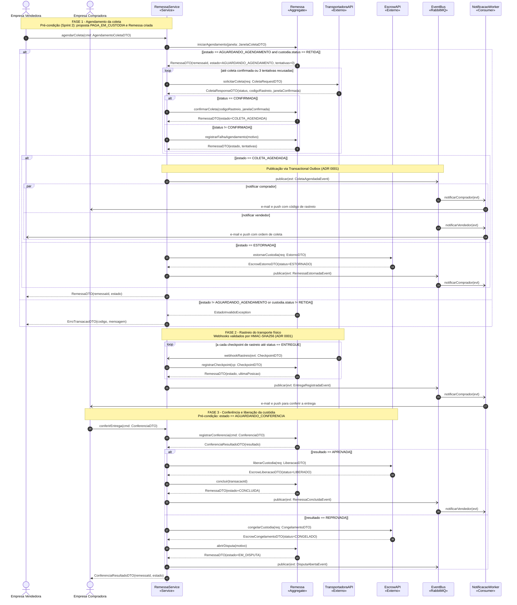
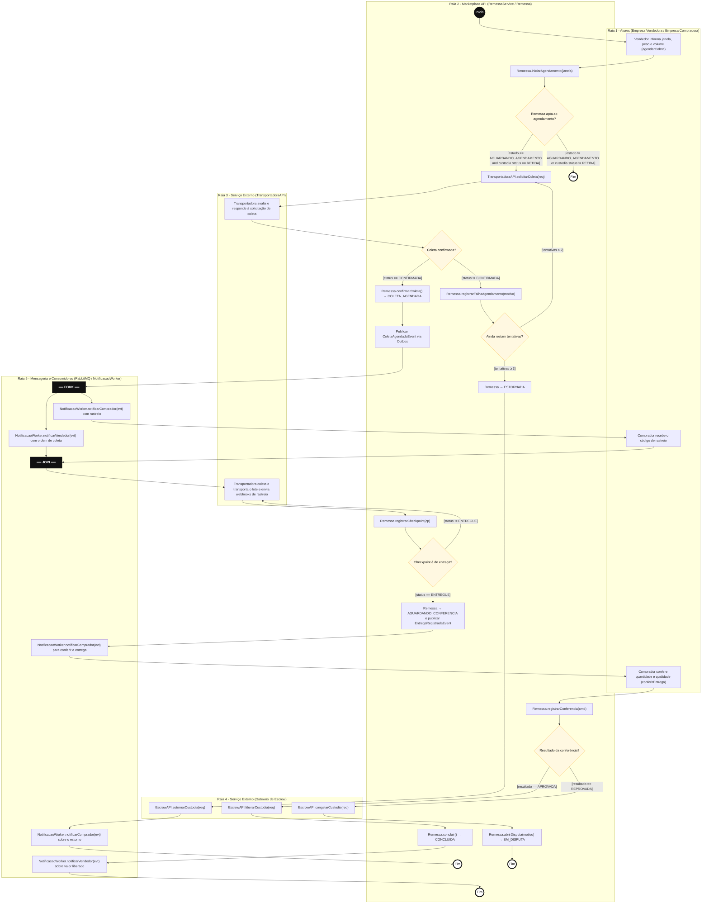
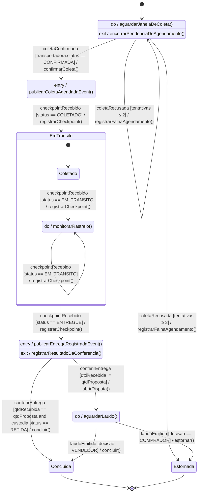
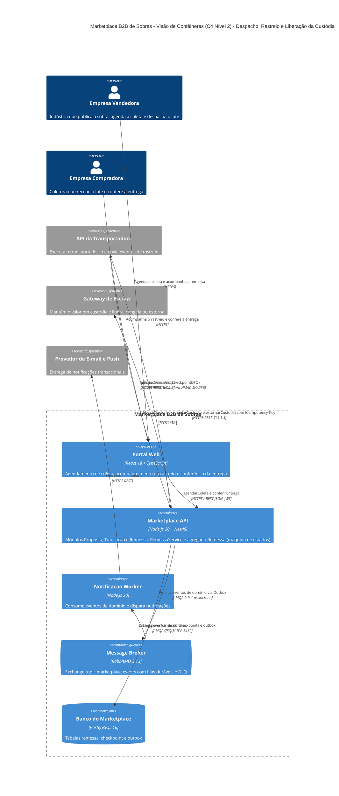

# APS 2 — Dossiê de Arquitetura Viva

**Aluno(a):** Cauã Oliveira Dos Santos
**Grupo:** Star
**Projeto:** Marketplace B2B de Sobras Industriais
**Funcionalidade crítica:** Logística e Transporte Físico das Sobras — Despacho, Rastreio e Liberação da Custódia

## 1. Funcionalidade

Depois que a proposta é paga em custódia , a plataforma precisa conduzir o lote até o comprador sem perder o controle do dinheiro. O transporte físico é executado por uma **transportadora externa**. A plataforma orquestra o processo em três fases:

1. **Agendamento da coleta.** O vendedor informa a janela, o peso e o volume, e a plataforma solicita a coleta à transportadora, com até 3 tentativas. Se todas forem recusadas, a custódia é estornada ao comprador.
2. **Rastreio.** A transportadora envia checkpoints por webhook (`COLETADO`, `EM_TRANSITO`, `ENTREGUE`), e a plataforma atualiza a `Remessa`.
3. **Conferência e liberação.** O comprador confere a quantidade recebida. Se estiver conforme, o valor é liberado ao vendedor. Se houver divergência, a custódia é congelada e abre-se uma disputa.

A criticidade vem do risco financeiro (liberar valor sem entrega, ou reter valor sem destino) e da dependência de sistemas externos que podem falhar ou enviar eventos duplicados e fora de ordem.

## 2. Artefato 1 — Diagrama de Sequência

Arquivo: [`docs/diagrams/sequencia.mmd`](docs/diagrams/sequencia.mmd)

## 3. Artefato 2 — Diagrama de Atividades com Raias

Arquivo: [`docs/diagrams/atividades.mmd`](docs/diagrams/atividades.mmd)

## 4. Artefato 3 — Diagrama de Transição de Estados

Arquivo: [`docs/diagrams/estados.mmd`](docs/diagrams/estados.mmd)

## 5. Artefato 4 — Visão Arquitetural C4 (Nível 2 — Contêineres)

Arquivo: [`docs/architecture/workspace.mmd`](docs/architecture/workspace.mmd) (Mermaid C4)

